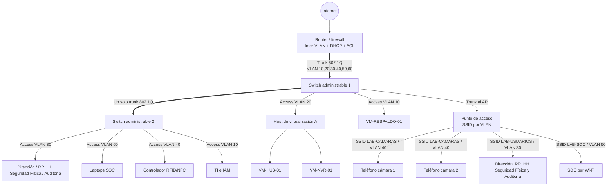

# Topología física

Usa un solo enlace entre switches. Si Hub y NVR están en hosts físicos distintos, conecta cada host a un puerto access VLAN 20. Si el hipervisor transporta varias VLAN, su puerto debe ser trunk y esa configuración debe documentarse por separado.
